# ulanzi-lab

A Claude Code companion deck for the **Ulanzi D200X** (5×3 LCD keys + one wide key) on **Windows + WSL** and **macOS**.

- **Never miss a waiting session.** When any Claude Code session needs a human decision (permission prompt, question, plan approval), its key blinks, a red wave ripples across the page, and a HITL key on every page counts the waiting sessions. Press it to jump straight to that session.
- **Usage at a glance.** 5-hour and 7-day rate-limit gauges with reset countdowns and a burn-rate forecast, taken from the Claude Code statusLine (no extra API calls, no credentials).
- **A developer dashboard.** Code review (GitHub *or* GitLab), CI, markets, hardware, media/mic, a Pomodoro timer, window snapping, and a Claude command pad.
- **Voice to text, on this PC.** A separate Voice profile records from the microphone and turns it into a punctuated transcript with a local Taiwanese-Mandarin speech model, copied to the clipboard. [See it below](#voice-profile-windows).

<p align="center">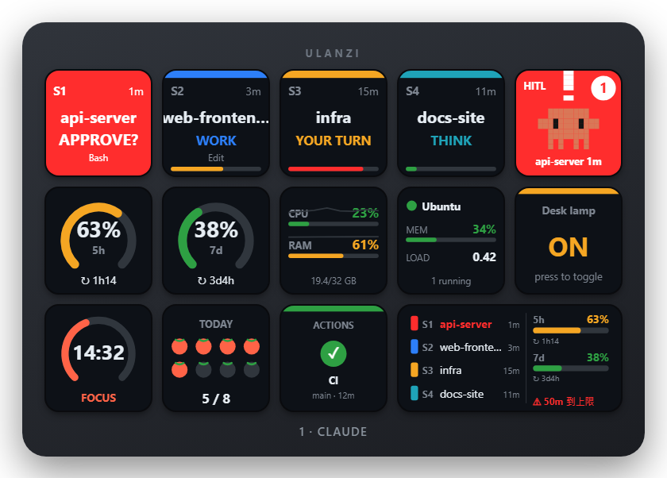</p>

<table>
<tr><td>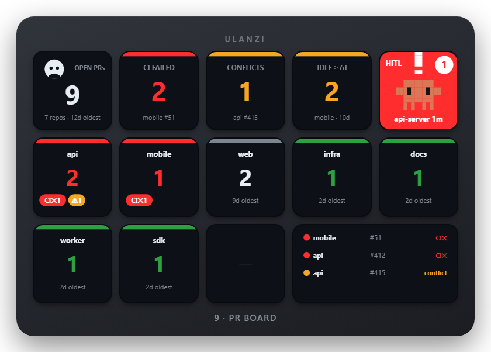</td><td>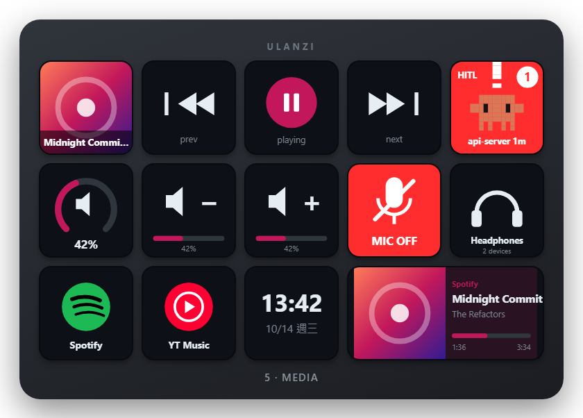</td></tr>
<tr><td>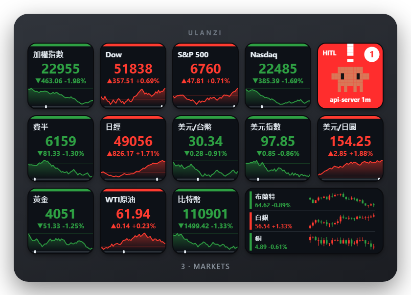</td><td>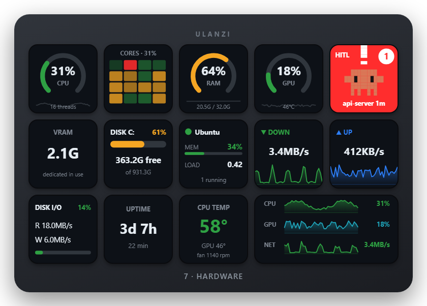</td></tr>
<tr><td>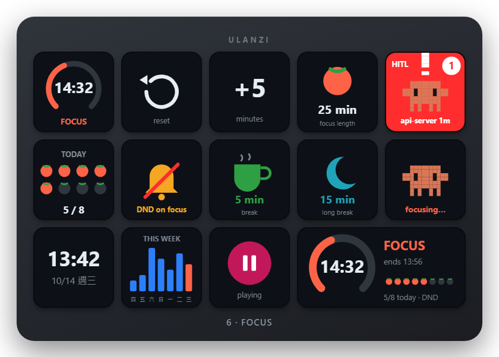</td><td>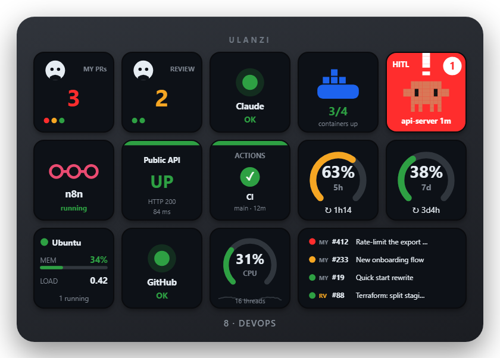</td></tr>
<tr><td>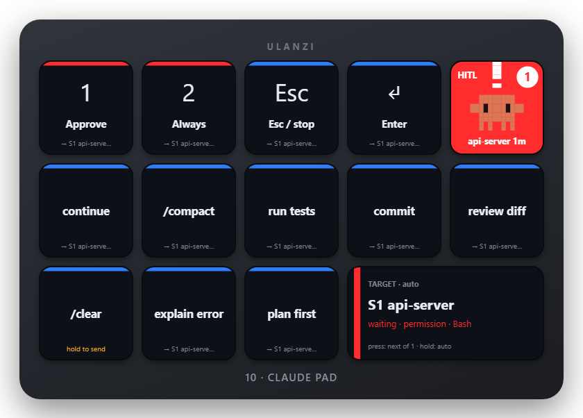</td><td>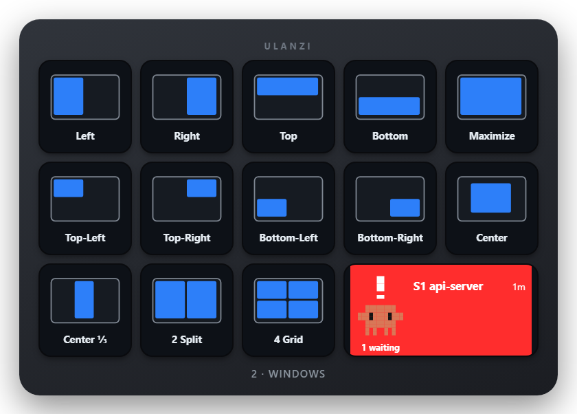</td></tr>
<tr><td>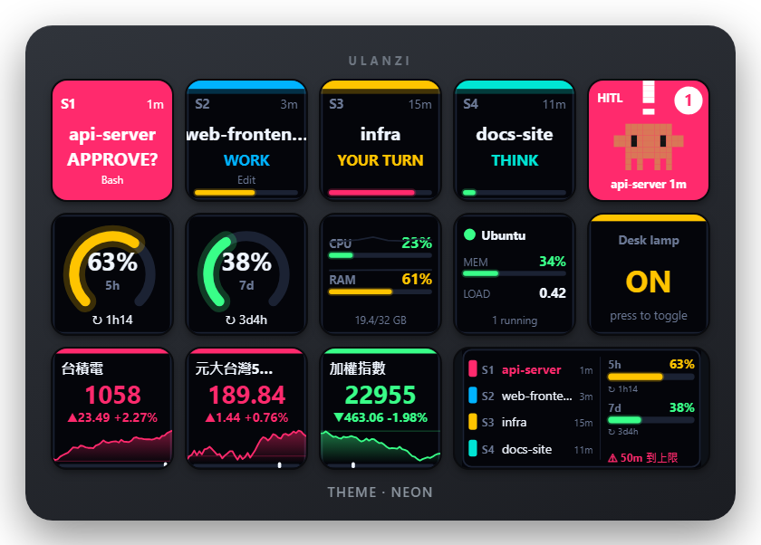</td><td>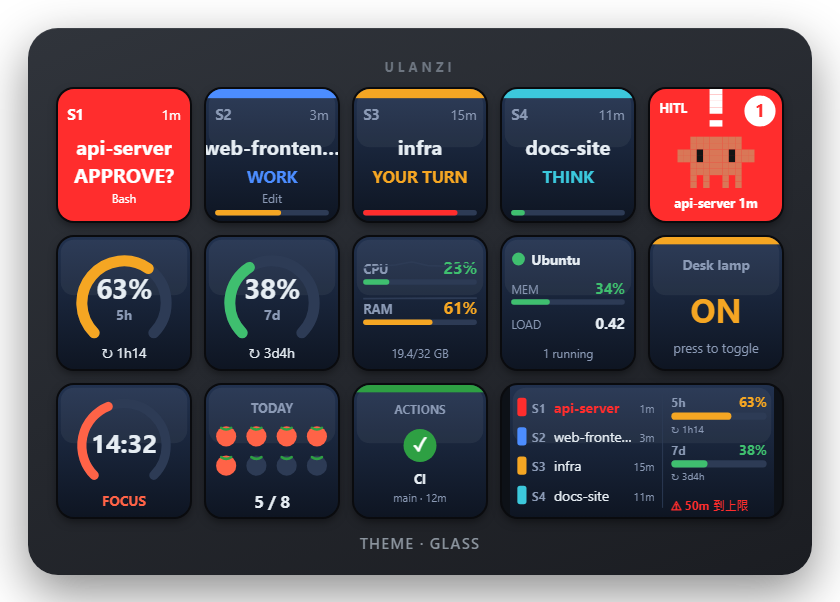</td></tr>
</table>

<sub>Screenshots are rendered from demo data with <code>node scripts/gallery.mjs</code>, using the plugin's real key templates.</sub>

Everything is driven by one Ulanzi Studio plugin (Node, bundled with Studio) plus small Claude Code hooks (in WSL on Windows, in your shell on macOS). A browser preview at `http://127.0.0.1:39300/` mirrors every page.

```
WSL or macOS: claude sessions ── hooks/ulanzi-hook.sh ───────────┐  POST http://127.0.0.1:39300  (/hook, /usage)
WSL or macOS: statusLine ─────── statusline/ulanzi-statusline.sh ─┘
                                                                  ▼
Ulanzi Studio ─spawns→ plugin app.js ─(Studio's Node unpatched → child on a patched system Node)→ src/main.js = hub + deck driver
   ▲ ws 127.0.0.1:3906   ├─ sessions.js     state machine, HITL queue, liveness
   └─ key images/presses ├─ providers/      quotes · sys · wsl / local · media · hw · devops (gh/glab) · iot
                         ├─ render*.js      SVG key templates (themes, charts, mascot)
                         ├─ win32.js        user32 via koffi → window layout / focus
                         ├─ ps/winhelper.ps1 media session, Core Audio, perf counters
                         ├─ mac/            macOS: JXA bridge (System Events) for layout, focus, media
                         └─ hub.js          HTTP + SSE + browser preview
```

## Quick start (Windows 11 + WSL2)

**Prerequisites**

- Node.js 22.23.4+ or 24.22.1+ (LTS with the October 2026 security fixes).
- Ulanzi Studio. Connect the D200X and open Studio once, so it creates a "Default Profile".
- WSL2 with `jq` and `curl`.
- Optional:
  - `tmux` for the Claude Pad and exact focus.
  - `gh` or `glab` (logged in) for code review.
  - Docker Desktop, n8n, or LibreHardwareMonitor for their keys.

**Install**

Clone the repo:

```bash
git clone <this-repo-url> ulanzi-lab
```

Go into it:

```bash
cd ulanzi-lab
```

Create your machine settings:

```bash
copy .env.example .env
```

Run the setup:

```bash
powershell -ExecutionPolicy Bypass -File scripts\setup.ps1
```

`setup.ps1` is idempotent. It:

1. Checks the prerequisites, including WSL mirrored networking.
2. Runs `npm install`.
3. Links the plugin into Ulanzi Studio (a junction to this repo).
4. Installs the hooks and statusLine into WSL's `~/.claude/settings.json`, after backing it up and keeping your existing hooks.
5. Generates the **ulanzi-lab** profile from your D200X profile and starts Studio on it.

Options:

| Option | What it does |
|---|---|
| `-EnvProfile <name>` | Copy `.env.<name>` to `.env` first. Useful when you keep several machine profiles. |
| `-FixWslConfig` | Add `networkingMode=mirrored` to `%USERPROFILE%\.wslconfig`, then ask you to run `wsl --shutdown`. The WSL hooks need it to reach `127.0.0.1`. |
| `-Distro <name>` | Use this WSL distro instead of the default. |
| `-SkipHooks` | Leave WSL's Claude Code settings alone. |

After pulling updates, re-run `scripts\setup.ps1`. Your `.env` is kept, so the deck still has your own pages and forge.

## Quick start (macOS)

**Prerequisites**

- macOS 12 or newer and Node.js 22.23.4+ or 24.22.1+ (LTS with the October 2026 security fixes).
- Ulanzi Studio for Mac. Connect the D200X and open Studio once, so it creates a "Default Profile".
- `jq` and `curl` (`brew install jq`).
- Optional:
  - `tmux` for the Claude Pad and exact focus.
  - `gh` or `glab` (logged in) for code review.
  - `switchaudio-osx` for the audio output key.
  - Docker Desktop or n8n for their keys.

**Install**

```bash
git clone <this-repo-url> ulanzi-lab
cd ulanzi-lab
cp .env.example .env
bash scripts/setup-mac.sh
```

The script:

1. Checks the prerequisites.
2. Runs `npm install`.
3. Symlinks the plugin into `~/Library/Application Support/Ulanzi/UlanziDeck/Plugins`.
4. Installs the hooks and statusLine into `~/.claude/settings.json`, after backing it up and keeping your existing hooks.
5. Generates the **ulanzi-lab** profile from your D200X profile and starts Studio on it.

`--env-profile <name>` and `--skip-hooks` work like their `setup.ps1` counterparts.

**Permissions.** macOS asks the first time a key needs one. Allow them for Ulanzi Studio:

- **Accessibility:** window layout keys.
- **Automation:** System Events, iTerm2 / Terminal (jump to a session's tab), Spotify / Music (media keys).

**What is different on macOS**

| Area | macOS |
|---|---|
| Sessions, HITL, usage, Claude Pad, code review | The same. Hooks, `tmux`, `gh` and `glab` run in your own shell instead of WSL. |
| Focus | tmux pane → iTerm2 / Terminal tab (matched by tty) → VS Code folder → the session's terminal app. |
| Window layout | Through System Events. **Restore** puts a window back where it was before its first snap. Full-screen windows can't be moved. |
| Media | Spotify and Music only, since macOS has no public now-playing API. Album art comes from Spotify. |
| Audio | Volume, mute, and mic (input volume 0). Switching outputs needs `SwitchAudioSource`. |
| Hardware | CPU, cores, RAM, GPU %, GPU memory in use, network, disk I/O, root volume. No temperatures and no disk busy %. |
| WSL keys | Replaced by Docker (page 1), System Health (Hardware) and RAM (DevOps). |

## Configuration (`.env`)

Every organisation- or machine-specific value lives in `.env` at the repo root. Git ignores it, along with every other `.env.*` except `.env.example`.
See [.env.example](.env.example) for the full list with comments. After editing, run `node scripts/make-profile.mjs --activate`, which rebuilds the pages and restarts Studio.

| Key | Default | Purpose |
|---|---|---|
| `ULANZI_LAB_FORGE` | `auto` | `gitlab`, `github`, or `auto` (whichever CLI is logged in; GitLab first) |
| `ULANZI_LAB_GITLAB_HOST` | (logged-in host) | Self-hosted GitLab host for `glab` |
| `ULANZI_LAB_GITHUB_HOST` | `github.com` | GitHub or GitHub Enterprise host for `gh` |
| `ULANZI_LAB_BOARD_SCOPE` | `involves:@me` | GitHub search qualifiers for the PR board (`org:x`, `repo:o/r`, …) |
| `ULANZI_LAB_ACTIONS_REPO` | (repos of your PRs) | `owner/name` for the GitHub Actions key |
| `ULANZI_LAB_HTTP_CHECKS` | Claude API | Up to two `url\|label` health checks |
| `ULANZI_LAB_WATCHLIST` | (none) | Up to 12 `SYMBOL:label` items. Adds a Watchlist page. |
| `ULANZI_LAB_WATCHLIST_STRIP` | (none) | Up to 3 items for the Watchlist wide key (mini candlesticks) |
| `ULANZI_LAB_DISTRO` | default distro | WSL distro the plugin talks to |
| `ULANZI_LAB_SOUNDS` | — | Your own sounds JSON, absolute or relative to the folder holding `.env` (the repo root); relative sound paths inside it are relative to the JSON file. It overrides only the keys it sets (`focusDone`, `breakDone`, `waiting`; `"off"` mutes). Defaults: [`config/sounds.windows.json`](plugin/com.ulanzi.nwpie.ulanziPlugin/config/sounds.windows.json), [`config/sounds.mac.json`](plugin/com.ulanzi.nwpie.ulanziPlugin/config/sounds.mac.json). Windows plays `.wav` only. |
| `ULANZI_LAB_NODE` | found automatically | Node that runs the plugin when Studio's bundled one lacks security fixes; `bundled` keeps Studio's |
| `ULANZI_LAB_N8N_URL` | `http://127.0.0.1:5678` | n8n key |
| `ULANZI_LAB_PORT` / `ULANZI_LAB_GAP` | `39300` / `0` | Hub port / gap between snapped windows |

Inside WSL, the hook and statusLine scripts read `ULANZI_HUB`, which defaults to `http://127.0.0.1:39300`.

## Pages

The page buttons (`0_3` / `1_3`) flip pages. Every page keeps a **HITL** key.

| # | Page | Keys |
|---|---|---|
| 1 | **Claude** | Sessions S1–S4, HITL. 5h / 7d usage, system, WSL, AIoT. Bottom row: Pomodoro timer + count, CI/CD. Wide key: fleet strip (sessions, usage bars, burn rate) |
| 2 | **Windows** | Snap the foreground window: halves, quarters, thirds, center, maximize. Presets: 2-split, 4-grid. Wide key: HITL banner |
| 3 | **Markets** | TAIEX, Dow, S&P 500, Nasdaq, SOX, Nikkei, USD/TWD, DXY, USD/JPY, gold, WTI, BTC. Wide key: Brent / silver / copper candlesticks |
| (4) | **Watchlist** | Only with `ULANZI_LAB_WATCHLIST`: your 12 symbols plus a 3-row candlestick strip |
| 4 | **Media** | Album art, prev / play / next, volume ring, vol −/+, **mic mute**, output device, Spotify, YouTube Music. Wide key: now playing |
| 5 | **Focus** | Pomodoro (25/50/15), reset, +5, breaks, today and week counts, DND, Clawd. Wide key: big timer |
| 6 | **Hardware** | CPU, per-core heatmap, RAM, GPU, VRAM, disk, WSL, network ↓↑, disk I/O, uptime, temps (LibreHardwareMonitor). Wide key: dashboard |
| 7 | **DevOps** | My PRs/MRs, review requests, Claude status, Docker, n8n, HTTP checks, CI (GitHub Actions or MR CI), usage, GitHub status. Wide key: PR/MR list |
| 8 | **PR / MR Board** | Open total, CI failed, conflicts, idle ≥ 7 days, and the 8 repos needing the most attention. Wide key: problem list |
| 9 | **Claude Pad** | Approve (1) / Always (2) / Esc / Enter, plus `continue`, `/compact`, run tests, commit, review diff, `/clear` (hold), explain error, plan first. Wide key: target session |

### Voice profile (Windows)

A separate profile, **ulanzi-lab Voice**: record from the microphone and get a transcript, all on this PC.

<p align="center">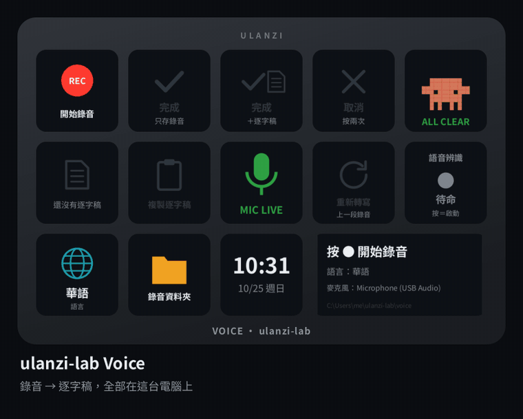</p>

<p align="center"><a href="docs/media/voice-demo.mp4">▶ Watch it with sound (MP4, 25 s)</a></p>

<sub>The deck states follow a script, but every key is drawn by the plugin's templates, the level meter follows the clip's real loudness, and the transcript is what the local speech-to-text service returned for it (a synthetic voice reading one sentence). Rebuild with <code>node scripts/voice-demo.mjs --audio &lt;file&gt;</code>.</sub>

<p align="center">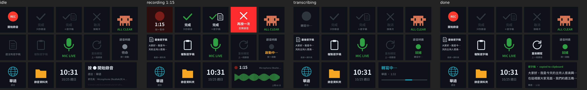</p>

| Row | Keys |
|---|---|
| 1 | **● Record** (press again: pause / resume), **Finish** (keep the recording), **Finish + transcript**, **Cancel** (press twice), HITL |
| 2 | **Last transcript** (hold: show it in its folder), **Copy** it, mic mute, **Transcribe again**, speech-to-text status |
| 3 | **Language** (華語 / English / 台語 / auto), recordings folder, clock. Wide key: timer and level meter while recording, then the first lines of the transcript |

Setup:

1. `winget install Gyan.FFmpeg` (Studio finds it without a restart).
2. In WSL: `services/voice-asr/install.sh` (add `--taigi` for Taiwanese Hokkien). It builds a venv and converts the official [Breeze-ASR-25](https://huggingface.co/MediaTek-Research/Breeze-ASR-25) weights to int8 under `~/.local/share/ulanzi-lab/voice-asr` (about 2 GB).
3. `npm run profile:voice` creates the profile; switch to it in Ulanzi Studio.

Each recording is saved under `~/ulanzi-lab/voice` (`C:\Users\<you>\ulanzi-lab\voice`; `ULANZI_LAB_VOICE_DIR` changes it) as `recordings/<time>.wav`, with `transcripts/<time>.txt` (punctuated) and `.srt`. (The first build used `Documents\ulanzi-lab\voice`; move anything there into the new folder.) The text is also copied to the clipboard. On a laptop CPU, transcription takes about as long as the recording. The service starts on the first key press (about 10 s), and stops after 15 idle minutes or when Studio quits.

**Code review works the same on GitHub and GitLab:**
- `glab` / `gh` run inside WSL (in your shell on macOS), so the CLI's own login is used.
- If you aren't logged in, pressing a review key opens a Windows Terminal tab (a Terminal window on macOS) that runs `glab auth login` / `gh auth login`.
- Holding any DevOps key refreshes it.

## Actions

| Action | Shows | Press | Hold |
|---|---|---|---|
| Claude Session | Slot S1–S8: project, state, time, context bar. **Waiting blinks** (red = permission, purple = question, orange = plan) | Focus the session | Dismiss |
| Claude HITL | Waiting count (Clawd mascot or big counter) | Focus the longest-waiting session; press again to cycle | Acknowledge all |
| Claude Usage | 5h / 7d ring, or the wide fleet strip | — | — |
| Stock Quote | TW (`2330`, `t00`, `otc:6488`) or Yahoo symbols (`NVDA`, `^DJI`, `GC=F`, `TWD=X`, `BTC-USD`) with an intraday chart. A comma list gives a candlestick strip. Red = up by default. | Open the quote page (Yahoo奇摩股市 for TW, Yahoo Finance otherwise; a strip opens its first symbol) | Refresh |
| Media & Audio | Now playing, volume, mic, output device | Play/pause, volume, mute, cycle | — |
| Focus Timer | Pomodoro parts | Start/pause, reset, +5, … | Reset |
| Hardware | One metric per key | Task Manager / Explorer | — |
| DevOps | PRs/MRs, review board, Actions, status, HTTP, Docker, n8n | Open in browser (or log in) | Refresh |
| Claude Prompt / Target | Text or keys to type into the target session's tmux pane | Send | Required for `/clear` |
| System / WSL / AIoT / Window Layout | As named | Task Manager / new WSL tab / toggle / snap | WSL: arm `wsl --shutdown` |
| Voice | Record / pause, finish, cancel, last transcript, copy, language, speech-to-text status (Windows) | As labelled | Last transcript: show in folder |

**Visuals:**
- A full-panel alert wave when a session starts waiting.
- Themes: classic, neon or glass, chosen on any HITL key.
- Intraday area charts and candlesticks on quote keys.
- Clawd moods: idle, working, waiting, done, celebrate, love.

## HITL details

- **Waiting** is triggered by:
  - `PermissionRequest`, or the `permission_prompt` notification.
  - Question notifications.
  - `AskUserQuestion` or `ExitPlanMode`.
- **Waiting clears** on:
  - The matching `PostToolUse` (by `tool_use_id`).
  - `UserPromptSubmit`.
  - `Stop`.
- **Sound.** An existing `permission_prompt` sound hook is kept, and our hook joins the same matcher group. The optional nag replays a chime every 60 s until you acknowledge.
- **Focus** tries these in order:
  1. The tmux pane.
  2. The VS Code window with that folder.
  3. A Windows Terminal tab whose title matches.
  4. Any Windows Terminal window.

  On macOS: the tmux pane, then the iTerm2 / Terminal tab with the session's tty, then the VS Code folder, then the terminal app.
- **Liveness.** Sessions whose claude process has exited are dropped within 30 s.

## Privacy and security

- **Hooks send metadata only.** They forward an allowlist (session id, event, notification type, cwd, tool name, focus hints). Prompts, tool inputs and transcripts never leave Claude Code, and the hub sanitizes the data again.
- **Hooks can't slow Claude down.** They print nothing, always exit 0, and post with a 1 s timeout. High-frequency tool hooks run `async`.
- **The hub is local-only.** It binds to `127.0.0.1` and only accepts `application/json` POSTs, which blocks cross-site forgery.
- **No credentials are read.** Usage comes from the statusLine. `gh` / `glab` use their own login inside WSL.
- **Claude Pad only types into tmux panes.** A session outside tmux is refused.
- **Voice stays on this PC.** Speech-to-text runs locally and listens on `127.0.0.1` only. Recordings and transcripts go to `~/ulanzi-lab/voice` (`C:\Users\<you>\ulanzi-lab\voice`), outside Documents so OneDrive doesn't sync them. The log records lengths and timings, never what you said.

## Development

```bash
npm test
```
Runs the `node:test` suite: state machine, parsers, page layouts, every SVG template.

```bash
npm run smoke
bash test/ci/shell-checks.sh
```
Boots the whole runtime with this OS's backends, and checks the hook, statusLine and hook installer.
CI runs the tests and the smoke test on Windows, macOS and Linux, plus a Windows + WSL job (`test/ci/wsl-bridge.mjs`) where the plugin on Windows Node discovers a session inside WSL.

```bash
npm run dev
```
Runs the hub, providers and preview standalone. Set `ULANZI_LAB_PORT=39301` if the plugin is also running.

```bash
npm run fake -- --n 4 --usage
```
Simulates Claude sessions.

```bash
node scripts/demo-states.mjs
```
Shows every session look on page 1.

```bash
npm run link        # Windows
npm run link:mac    # macOS
```
Re-links the plugin and restarts Ulanzi Studio.

```bash
node scripts/gallery.mjs
```
Re-renders the README screenshots in `docs/images/` from demo data. It needs Chrome or Edge.

- Logs: `%LOCALAPPDATA%\ulanzi-lab\plugin.log` (macOS: `~/Library/Application Support/ulanzi-lab/plugin.log`). State: `state.json` and `pomodoro.json` in the same folder.
- Node debugging: start Studio with `--nodeRemoteDebug`, then attach to `127.0.0.1:9231`.
- Pages live in [src/pages.js](plugin/com.ulanzi.nwpie.ulanziPlugin/src/pages.js). The profile generator and the preview share it.

## Notes and limits

- **Quotes.** They come from TWSE MIS when it's reachable, otherwise from Yahoo's chart API (unofficial). Market holidays aren't modelled.
- **Windows Terminal.** It can't focus a tab by id, so tab focus is a best-effort title match. tmux and VS Code focus are exact.
- **Elevated windows.** The plugin isn't elevated, so it can't move them.
- **Port.** The hub uses port 39300 because some machines reserve the 45000–48000 range.
- **Node inside Ulanzi Studio.** Studio 3.4 for Windows runs plugins on its own bundled Node 20.12.2 (check the Mac build's with the `plugin start` line in the log), which is past end of life and gets no security fixes. So `app.js` checks its own Node first. When it lacks security fixes and a patched Node is installed (PATH, the usual install folders, or `ULANZI_LAB_NODE`), it only supervises: the plugin runs in a child process on that Node and stops when Studio stops the parent. Without a patched Node, or if the child keeps crashing, the plugin runs on Studio's Node and logs a warning. Keep your system Node updated. The hub only listens on `127.0.0.1` and accepts JSON posts only. Your own Node (tools, `npm run dev`, CI) must have them: the minimum per release line is in [src/node-floor.js](plugin/com.ulanzi.nwpie.ulanziPlugin/src/node-floor.js), which the setup scripts and CI check.

> **Tip: let Ulanzi Studio use your system Node (Windows).** Studio starts plugins with its bundled
> `C:\Program Files (x86)\Ulanzi Studio\nodejs\node.exe`. If you point that file at your system Node with a
> symbolic link, every Node security update you install applies to all Studio plugins, without waiting for an
> Ulanzi release. In an administrator PowerShell:
>
> ```powershell
> $dir    = 'C:\Program Files (x86)\Ulanzi Studio\nodejs'
> $target = & (Get-Command node -CommandType Application -ErrorAction Stop).Source -p process.execPath
> if ($target -and (Test-Path $target)) {
>   # Studio and its plugins run this node.exe, so it can't be renamed while they run: stop them first.
>   Get-Process UlanziDeck -ErrorAction SilentlyContinue | Stop-Process -Force
>   Get-Process node -ErrorAction SilentlyContinue | Where-Object { $_.Path -like "$dir*" } | Stop-Process -Force
>   Start-Sleep 2
>   Rename-Item "$dir\node.exe" node.bundled.exe -ErrorAction Stop   # keep Studio's copy for undo
>   try { New-Item -ItemType SymbolicLink -Path "$dir\node.exe" -Target $target -ErrorAction Stop | Out-Null }
>   catch { Rename-Item "$dir\node.bundled.exe" node.exe; throw }   # link failed: put Studio's copy back
>   & "$dir\node.exe" --version                                     # should print your Node's version
> }
> ```
>
> The second line finds the real `node.exe` behind any version-manager shim. If `$target` sits in a per-shell or temporary folder (for example fnm's `fnm_multishells`), point the link at a stable install such as `C:\Program Files\nodejs\node.exe` instead. Nothing is stopped or renamed unless the target exists.
> Then start Studio as usual (Start menu), not from this window: anything started here runs as administrator, and so would every plugin. Afterwards the `plugin start` line in the plugin log shows your Node's version, and the plugin no longer needs to switch Node itself.
> - **Undo:** with Studio closed, delete the link and rename `node.bundled.exe` back to `node.exe`.
> - **Before updating Studio, undo the link,** then re-apply it afterwards. The installer runs elevated and could otherwise write its old Node through the link over your system Node. If an update already went through with the link in place, check `node -v` and reinstall Node if it changed. If `nodejs\node.exe` is still a link, it now points at the fixed Node again and nothing else is needed. If the update replaced the link with a plain file, delete the stale `node.bundled.exe` and re-apply.
> - **Other plugins** then run on your Node too. If one of them breaks on a newer major version, undo.
> - **macOS:** the bundled Node sits inside the signed app bundle, and changing it can stop Studio from launching. Rely on the automatic switch described above instead.

## Uninstall

Run this from the repo, inside WSL (or in a terminal on macOS):

```bash
bash scripts/install-hooks.sh --uninstall
```

Then remove the plugin link. On Windows:

```bash
powershell -ExecutionPolicy Bypass -File scripts\link-plugin.ps1 -Unlink
```

On macOS:

```bash
bash scripts/link-plugin.sh --unlink
```

## Third-party code

- **Ulanzi SDK.** `plugin/.../libs/ulanzi-api` and `libs/ulanzi-html` are from the [UlanziDeckPlugin-SDK](https://github.com/UlanziTechnology/UlanziDeckPlugin-SDK) (Apache-2.0).

See [docs/survey.md](docs/survey.md) for the research behind the design. See [CONTRIBUTING.md](CONTRIBUTING.md) and [SECURITY.md](SECURITY.md) to contribute or report a problem.

## License

[MIT](LICENSE). Third-party code keeps its own license (see [NOTICE](NOTICE)).
